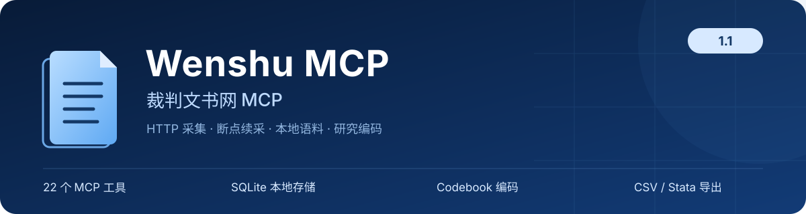
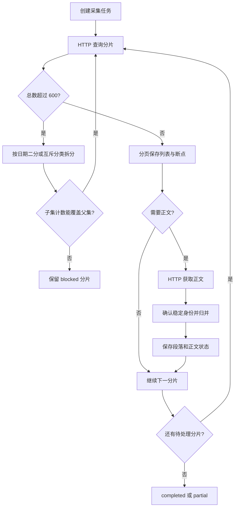
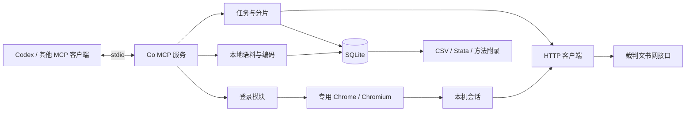
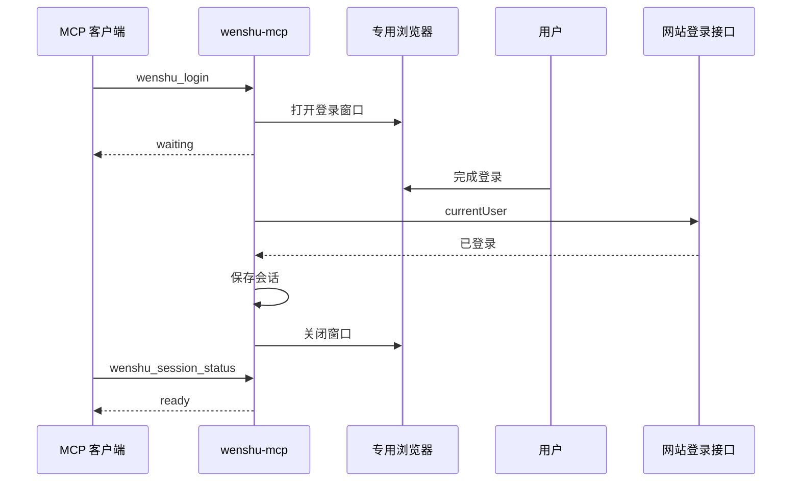

<div align="center">



[](#主要功能)
[](go.mod)
[](https://modelcontextprotocol.io)
[](#工具说明)
[](#数据目录)

**China Wenshu MCP · 中国裁判文书网 MCP · 1.0**

[快速开始](#快速开始) · [使用示例](#使用示例) · [工具说明](#工具说明) · [采集流程](#采集流程) · [架构](#架构) · [配置](#配置) · [故障排查](#故障排查)

</div>

---

Wenshu MCP 是在本机运行的中国裁判文书网 [MCP](https://modelcontextprotocol.io) 服务。接入 Codex、Claude Desktop 等支持 stdio MCP 的客户端后，可以用自然语言检索裁判文书、创建批量采集任务、阅读正文、管理本地语料、按 codebook 编码，并导出 CSV、Stata 数据与研究方法附录。

通过自动分片、持久化任务和本地编码，把检索结果整理为可分析、可回查的研究数据。

## 主要功能

- **文书检索**：按关键词、裁判日期、法院、案件类型等条件查询，读取列表与分类计数。
- **批量采集**：程序生成请求参数；检索超过 600 条时，自动按日期和互斥分类拆分。
- **断点续采**：保存任务、分片、页码和正文状态；暂停、进程退出或会话更新后，使用同一任务 ID 继续。
- **正文与语料库**：保存原始列表和正文对象，生成段落编号与字符位置，支持本地中文子串检索。
- **文书去重**：按稳定文书编号归档，合并重复记录并保留访问链接。
- **Codebook 编码**：支持 JSON/YAML 规则、文书级和段落级编码、人工复核、原文证据、多编码员及规则版本。
- **研究导出**：输出 CSV、原生 Stata 118、原始语料 JSONL、编码历史、字段说明和方法附录。

发行包提供独立可执行程序，研究数据保存在本机 SQLite 语料库中。

## 快速开始

### 1. 下载并解压

从 [Releases](https://github.com/ChengDSYJ-Studio/China-Wenshu-MCP/releases/latest) 下载对应平台的 **1.0 完整发行包**：

| 系统 | 发行包 | 安装入口 |
| --- | --- | --- |
| macOS · Apple 芯片 | [wenshu-mcp-1.0-macOS-arm64.zip](https://github.com/ChengDSYJ-Studio/China-Wenshu-MCP/releases/download/v1.0/wenshu-mcp-1.0-macOS-arm64.zip) | 双击 `安装设置.command` |
| macOS · Intel | [wenshu-mcp-1.0-macOS-x64.zip](https://github.com/ChengDSYJ-Studio/China-Wenshu-MCP/releases/download/v1.0/wenshu-mcp-1.0-macOS-x64.zip) | 双击 `安装设置.command` |
| Windows · x64 | [wenshu-mcp-1.0-Windows-x64.zip](https://github.com/ChengDSYJ-Studio/China-Wenshu-MCP/releases/download/v1.0/wenshu-mcp-1.0-Windows-x64.zip) | 双击 `安装设置.cmd` |
| Windows · ARM64 | [wenshu-mcp-1.0-Windows-arm64.zip](https://github.com/ChengDSYJ-Studio/China-Wenshu-MCP/releases/download/v1.0/wenshu-mcp-1.0-Windows-arm64.zip) | 双击 `安装设置.cmd` |
| Linux · x64 | [wenshu-mcp-1.0-Linux-x64.zip](https://github.com/ChengDSYJ-Studio/China-Wenshu-MCP/releases/download/v1.0/wenshu-mcp-1.0-Linux-x64.zip) | 运行 `./安装设置.sh` |
| Linux · ARM64 | [wenshu-mcp-1.0-Linux-arm64.zip](https://github.com/ChengDSYJ-Studio/China-Wenshu-MCP/releases/download/v1.0/wenshu-mcp-1.0-Linux-arm64.zip) | 运行 `./安装设置.sh` |

每个发行包都包含对应平台的可执行程序、安装向导、示例和文档。

### 2. 运行安装设置

安装向导会完成：

1. 选择要接入的客户端，支持同时选择多个；
2. 自动寻找本机浏览器，或下载配套浏览器；
3. 把程序安装到数据目录，合并客户端配置；
4. 连接 MCP 服务并显示已加载的工具数量。

| 客户端 | 配置方式 |
| --- | --- |
| Codex | 自动写入 TOML 配置 |
| Claude Desktop | 自动写入 JSON 配置 |
| Claude Code | 自动写入全局 MCP 配置 |
| Cursor | 自动写入 MCP 配置 |
| Windsurf | 自动写入 MCP 配置 |
| Gemini CLI | 自动合并设置 |
| 通用 MCP 客户端 | 生成可导入的配置文件 |

浏览器支持 Chrome、Edge、Chromium 和 Brave。配套浏览器下载默认使用 **npmmirror 国内镜像**，向导也提供官方源。可以通过 `--download-source` 或 `WENSHU_DOWNLOAD_SOURCE` 指定下载源。

### 3. 重载客户端并开始使用

在客户端中重载 `wenshu`，然后对 AI 说：

> 帮我登录裁判文书网。

在弹出的窗口完成登录后，即可开始检索、采集和整理研究语料。例如：

> 采集 2020 年提到“未成年人”的文书，保存正文，超过 600 条自动拆分。采集后按这份 codebook 编码并导出 Stata 数据。

更多安装选项见 [安装说明](docs/INSTALL.md)。

## 使用示例

| 提问示例 | 使用的工具 |
| --- | --- |
| 帮我登录裁判文书网，看看会话是否有效 | `wenshu_login`、`wenshu_session_status` |
| 查找 2020 年 1 月 1 日提到“未成年人”的文书 | `wenshu_search` |
| 这些文书分别来自哪些省份，有多少篇 | `wenshu_facets` |
| 创建一项包含正文的采集任务，超过 600 条自动拆分 | `wenshu_task_create`、`wenshu_task_start` |
| 看看任务进行到哪里了，哪些分片还没完成 | `wenshu_task_status`、`wenshu_task_shards` |
| 暂停当前采集，稍后从断点继续 | `wenshu_task_pause`、`wenshu_task_start` |
| 读取这篇文书的正文和段落 | `wenshu_document` |
| 在本地语料中查找包含“违约金”的文书 | `wenshu_corpus_search` |
| 导入这份 codebook，给刚才采集的文书编码 | `wenshu_codebook_import`、`wenshu_code_apply` |
| 按第 18 段的原文保存一条人工编码 | `wenshu_code_put` |
| 查看某位编码员的取值和证据 | `wenshu_codings` |
| 导出这项任务的 CSV、Stata 数据和方法附录 | `wenshu_export` |
| 单独生成这项采集任务的方法说明 | `wenshu_methods` |

## 工具说明

共 **21 个工具**。Codex 可能显示带命名空间的名称，例如 `mcp__wenshu__wenshu_search`。下面使用服务中的原始工具名。

| 工具 | 说明 | 访问网站 |
| --- | --- | :---: |
| [`wenshu_login`](#wenshu_login) | 打开专用浏览器登录并保存会话 | 是 |
| [`wenshu_session_status`](#wenshu_session_status) | 查看会话；可检查网站登录状态 | 按参数 |
| [`wenshu_auth_import`](#wenshu_auth_import) | 导入本地会话文件 | 否 |
| [`wenshu_search`](#wenshu_search) | 检索一页文书 | 是 |
| [`wenshu_facets`](#wenshu_facets) | 查询分类计数 | 是 |
| [`wenshu_dictionary`](#wenshu_dictionary) | 读取内置网站字典 | 否 |
| [`wenshu_document`](#wenshu_document) | 读取本地文书，或获取正文并入库 | 按参数 |
| [`wenshu_task_create`](#wenshu_task_create) | 创建持久化采集任务 | 否 |
| [`wenshu_task_start`](#wenshu_task_start) | 后台运行或恢复任务 | 是 |
| [`wenshu_task_pause`](#wenshu_task_pause) | 暂停任务，保留断点 | 否 |
| [`wenshu_task_status`](#wenshu_task_status) | 查看任务状态和数量 | 否 |
| [`wenshu_task_list`](#wenshu_task_list) | 列出本地任务 | 否 |
| [`wenshu_task_shards`](#wenshu_task_shards) | 查看分片条件、计数和断点 | 否 |
| [`wenshu_corpus_search`](#wenshu_corpus_search) | 检索本地语料 | 否 |
| [`wenshu_codebook_import`](#wenshu_codebook_import) | 导入 JSON/YAML codebook | 否 |
| [`wenshu_codebook_list`](#wenshu_codebook_list) | 列出规则及版本 | 否 |
| [`wenshu_code_apply`](#wenshu_code_apply) | 按规则编码，报告冲突 | 否 |
| [`wenshu_code_put`](#wenshu_code_put) | 保存人工编码和证据 | 否 |
| [`wenshu_codings`](#wenshu_codings) | 分页查询编码记录 | 否 |
| [`wenshu_export`](#wenshu_export) | 导出研究数据包 | 否 |
| [`wenshu_methods`](#wenshu_methods) | 生成或保存方法附录 | 否 |

### 通用约定

- **工具返回**：工具通过结构化结果返回数据，错误状态由 `isError=true` 标识；后台任务通过状态工具查询进度。
- **任务编号**：`job_id` 来自创建任务时返回的 `id`，暂停或恢复时使用同一编号。
- **文书编号**：正文确认后的 `doc_id` 使用稳定的 `s5`；`remote_id` 是网站访问用的临时编号。旧临时编号仍可通过别名找到已归档文书。
- **文书归档**：列表记录在获取正文后通过稳定编号完成身份确认与归并。
- **分页**：本地语料、编码查询使用 `offset` 与 `limit`；网站列表使用 `page` 与 `page_size`。
- **时间与日期**：日期使用 `YYYY-MM-DD`；采集日志使用北京时间并带时区。
- **路径**：文件导入和导出建议使用绝对路径。

### wenshu_login

启动登录浏览器并返回 `waiting` 状态。登录成功后保存会话，状态更新为 `ready`。

| 参数 | 默认值 | 说明 |
| --- | --- | --- |
| `chrome` | 自动查找 | Chrome／Chromium 可执行文件的完整路径 |

用 `wenshu_session_status` 查看 `login.state`；登录完成后为 `ready`，后续可复用已保存的会话。

### wenshu_session_status

| 参数 | 默认值 | 说明 |
| --- | --- | --- |
| `check` | `false` | 为 `true` 时在线检查登录状态 |

返回 `configured`、会话保存时间、登录流程状态和程序版本。在线检查时还返回 `usable`、`checked_via=currentUser`。

### wenshu_auth_import

`path` 为本地会话文件的完整路径。导入成功后返回会话配置状态；需要确认在线有效性时，再调用 `wenshu_session_status(check=true)`。

### wenshu_search

按指定条件读取一页列表。

| 参数 | 默认值 | 说明 |
| --- | --- | --- |
| `query` | 必填 | 查询对象，字段见下表 |
| `page` | 1 | 页码，从 1 开始 |
| `page_size` | 5 | 每页返回条数 |

查询对象：

| 字段 | 说明 |
| --- | --- |
| `keyword` | 全文关键词 |
| `start_date`、`end_date` | 裁判日期范围，含首尾日期，两个字段一起填写 |
| `conditions` | 网站原始条件数组，如 `{"key":"s8","value":"03"}` |
| `sort` | 默认 `s51:asc`；支持裁判日期 `s51`、法院层级 `s50`、程序 `s52` 的 `asc/desc` 排序 |

常用原始条件：

| 条件 | 含义 | 条件 | 含义 |
| --- | --- | --- | --- |
| `s21` | 全文关键词 | `s2` | 法院名称 |
| `s4` | 法院层级 | `s6` | 文书类型 |
| `s8` | 案件类型 | `s9`、`s10` | 审判程序 |
| `s11` 等 | 案由层级 | `s33` | 法院省份 |
| `s42` | 裁判年份 | `cprq` | 裁判日期区间 |

同一条件可选择便捷字段或原始字段填写，例如全文关键词使用 `keyword` 或 `conditions.s21`。

```json
{
  "query": {
    "keyword": "未成年人",
    "start_date": "2020-01-01",
    "end_date": "2020-01-01",
    "conditions": [{"key": "s8", "value": "03"}]
  },
  "page": 1,
  "page_size": 5
}
```

返回 `total`、`records`、`page`、`page_size`。批量采集通过任务工具自动处理超过 600 条的检索结果。

### wenshu_facets

| 参数 | 说明 |
| --- | --- |
| `query` | 与 `wenshu_search` 相同的查询对象 |
| `field` | 分类字段，例如 `s42` 年份、`s33` 省份、`s8` 案件类型 |

返回 `value` 与 `count` 的列表。分类计数可用于描述样本，也用于采集任务选择分片。

### wenshu_dictionary

`key` 可选。省略时返回字典名称及字段说明；指定时读取对应字典。

可用字典包括 `ajlx` 案件类型、`wslx` 文书类型、`fycj` 法院层级、`spcx` 审判程序、`ay` 案由等。字典来自项目随附的站点字典快照。

### wenshu_document

| 参数 | 默认值 | 说明 |
| --- | --- | --- |
| `doc_id` | 必填 | 本地稳定 ID 或已知网站访问编号 |
| `fetch` | `false` | 按需获取正文并保存到本地 |
| `force` | `false` | 与 `fetch=true` 一起使用，刷新已保存的正文 |

返回元数据、正文、原始字段和段落。每段包含 `number`、`section`、`text`、`start`、`end`。

字符位置基于规范化全文，按 Unicode 码点计算，采用左闭右开区间。段落类型包括网站分段名称及“全文”。

### wenshu_task_create

创建持久化任务，随后通过 `wenshu_task_start` 启动。

| 参数 | 默认值 | 说明 |
| --- | --- | --- |
| `name` | 必填 | 任务名称 |
| `query` | 必填 | 查询对象 |
| `fetch_body` | 必填 | 是否采集正文 |
| `page_size` | 5 | 列表页长 |
| `split_fields` | 内置顺序 | 可选的互斥分类拆分顺序 |

```json
{
  "name": "2020 年未成年人相关文书",
  "query": {
    "keyword": "未成年人",
    "start_date": "2020-01-01",
    "end_date": "2020-12-31"
  },
  "fetch_body": true,
  "page_size": 5
}
```

返回任务 `id`、规范化后的条件、创建时间和初始状态。

### wenshu_task_start

| 参数 | 默认值 | 说明 |
| --- | --- | --- |
| `job_id` | 必填 | 已创建的任务编号 |
| `max_pages` | 0 | 本次最多处理多少次主循环列表调用；0 表示不限 |
| `request_interval_ms` | 服务配置 | 本次请求间隔（毫秒）；0 为连续请求 |

工具立即返回，采集在后台继续。`max_pages` 统计主循环列表调用，包括用于发现超量分片的查询；分类计数核对和正文获取随分片处理执行。

暂停或可恢复错误处理后，再调用同一 `job_id` 即可续采。已保存记录通过本地缓存复用；新的临时编号在取得正文后确认稳定身份并归并。

### wenshu_task_pause

传入 `job_id` 请求暂停。正在执行的任务可能先返回 `pausing`，随后变为 `paused`。已提交的列表页、正文及分片断点保留。

### wenshu_task_status

传入 `job_id`，返回任务条件、状态、最近错误、文书数、可用正文数、不公开正文数和各状态分片数量。

| 状态 | 含义 |
| --- | --- |
| `created` | 已创建，等待启动 |
| `running` | 正在采集 |
| `pausing` | 已请求暂停，正在结束当前操作 |
| `paused` | 已暂停，可从断点恢复 |
| `error` | 会话、网络或数据处理失败，排除原因后可重试 |
| `partial` | 部分分片待处理 |
| `completed` | 当前任务的采集步骤已完成 |

`completed` 表示程序完成了该查询任务。网站公开范围与样本覆盖情况记录在方法附录中；列表记录可通过正文确认稳定身份。

### wenshu_task_list

列出数据目录中的采集任务，包括状态、条件和数量。

### wenshu_task_shards

传入 `job_id`，查看分片的父子关系、查询条件、接口计数、下一页和失败原因。

`split` 表示已拆成子分片；`blocked` 记录需要进一步处理的范围。遇到 `partial` 时，通过分片条件和原因设计更细的采集任务。

### wenshu_corpus_search

| 参数 | 默认值 | 说明 |
| --- | --- | --- |
| `job_id` | 全库 | 可限制到某个任务 |
| `keyword` | 不限 | 正文和原始字段中的中文子串 |
| `limit` | 20 | 返回条数，1–10000 |
| `offset` | 0 | 本地分页偏移 |

返回文书摘要和元数据。需要全文与段落时，继续调用 `wenshu_document`。

### wenshu_codebook_import

`path` 指向 JSON 或 YAML 文件。Codebook 至少包含 `name`、`version`、`variables`。

```yaml
name: minor_mentions
version: "1.0"
variables:
  - name: mentions_minor
    label: 提及未成年人
    type: boolean
    unit: document
    default: false
    rules:
      - pattern: 未成年人|未满十八周岁
        value: true
```

| 字段 | 含义 |
| --- | --- |
| `type` | `boolean`、`integer`、`number`、`string`、`category` |
| `unit` | `document` 或 `paragraph` |
| `rules` | 正则表达式和对应取值，可用 `sections` 限定段落类型 |
| `default` | 规则未命中时使用的默认值，省略时记为缺失 |
| `values` | 分类变量的代码与标签映射 |

正则使用 Go RE2 语法。同名同版本可重复导入相同内容；规则内容变化时必须提升版本。完整示例见 [examples/codebook.yaml](examples/codebook.yaml)。

### wenshu_codebook_list

返回本地 codebook、版本、变量和规则。

### wenshu_code_apply

| 参数 | 默认值 | 说明 |
| --- | --- | --- |
| `book`、`version` | 必填 | 已导入的规则名称和版本 |
| `job_id` | 全库 | 可限制编码范围 |
| `coder` | `rule:名称:版本` | 编码员／规则运行标识 |

对可用正文执行规则，返回处理文书数、写入编码数和冲突列表。多个不同取值同时命中时交由研究者复核。

规则结果记录文本匹配及其证据，研究者可以在此基础上进行人工复核。

### wenshu_code_put

保存一条人工编码：

```json
{
  "doc_id": "已入库文书ID",
  "book": "minor_mentions",
  "version": "1.0",
  "variable": "mentions_minor",
  "unit": 0,
  "coder": "researcher_1",
  "value": "true",
  "evidence": [{"paragraph": 18, "quote": "未成年人"}],
  "note": "人工复核"
}
```

- 文书级编码的 `unit=0`；段落级编码填写段落号。
- `value` 按 codebook 类型检查。客户端把该字段作为字符串时，布尔值使用 `"true"`／`"false"`，数值使用 `"1"`／`"12.5"`；保存后恢复为相应类型，文本变量保持原意。
- `evidence` 的引文必须来自指定段落；阴性或缺失编码可以用 `note` 说明原因。
- 正文变化后，旧编码标记为 `stale`，供复核；文书身份归并前的编码保留在历史记录中。

### wenshu_codings

用 `job_id`、`book`、`version`、`coder` 筛选，参数均可省略。分页参数为 `limit`（默认 100，最多 10000）与 `offset`（默认 0）。

返回取值、编码单位、编码员、证据、方法、时间及待复核标记。

### wenshu_export

| 参数 | 默认值 | 说明 |
| --- | --- | --- |
| `directory` | 必填 | 新建的输出目录 |
| `job_id` | 全库 | 导出范围 |
| `format` | `both` | `csv`、`dta` 或 `both` |
| `book`、`version`、`coder` | 可选 | 选择进入宽表的 codebook、版本和编码员 |

导出使用一致的 SQLite 快照，并逐批处理语料。各编码员的结果独立保存，宽表通过 `coder` 选择相应记录。

| 文件 | 内容 |
| --- | --- |
| `documents.csv/.dta` | 文书元数据、正文、来源链接及选定的文书级编码 |
| `paragraphs.csv/.dta` | 段落号、段落类型、文本和字符位置 |
| `codings.csv/.dta` | 编码值、编码员、原文证据和复核状态 |
| `corpus.jsonl` | 原始列表／正文对象及规范化文书 |
| `coding_history.jsonl` | 文书身份归并前的编码记录 |
| `codebooks.json`、`variables.json` | 编码规则、取值标签和字段定义 |
| `methods.md` | 采集与编码方法附录 |
| `open_in_stata.do` | 在导出目录打开数据的 Stata 示例 |

Stata 文件使用 118 格式，需要 Stata 14+ 读取。中文以 UTF-8 保存，长正文使用 `strL`；数值缺失为 `.`，文书级布尔变量导出为 1/0。分类代码保留原值，标签映射写入 codebook。

### wenshu_methods

`job_id` 可限定任务；`path` 可指定 Markdown 文件路径，省略时直接返回 Markdown。

附录包括检索条件、日期、分片、完成情况、请求与失败计数、正文处理、编码方式及样本覆盖限制。

## 采集流程



1. 规范化检索条件，并在 SQLite 创建任务与初始分片。
2. 查询分片总数。超过 600 条时，优先对日期范围二分；再尝试年份、地域、法院、案件类型等互斥分类。
3. 分类拆分须核对分类总数和各子查询计数。默认字段顺序为 `s42,s33,s39,s40,s8,s6,s4,s9,s10`。
4. 每页文书、任务归属及下一页断点在同一事务提交；异常页保留重试位置。
5. 正文逐篇保存，确认稳定身份后归并，再生成段落。已经保存的正文可以直接读取。
6. 记录每个分片的处理结果与后续操作信息，通过任务状态和方法附录展示进度。

拆分采用日期及互斥分类，每个分片的计数、检索条件和完成状态都进入方法附录，便于回查样本覆盖情况。

## 架构



技术栈：

- **Go 1.27.3+**：构建单个可执行文件。
- **MCP**：官方 [Go SDK](https://github.com/modelcontextprotocol/go-sdk)，使用 stdio 传输。
- **登录**：[go-rod](https://github.com/go-rod/rod) 与 Chrome DevTools Protocol，获取并保存登录会话。
- **采集**：Go `net/http` 直接调用接口，程序生成请求参数并解密响应。
- **存储**：SQLite，保存任务、正文、段落、文书别名和编码。
- **导出**：Go 直接生成 CSV 与 Stata 118 文件。

| 模块 | 文件 | 职责 |
| --- | --- | --- |
| MCP 入口 | [server.go](internal/wenshu/server.go) | 注册 21 个工具及参数 |
| HTTP 客户端 | [client.go](internal/wenshu/client.go)、[crypto.go](internal/wenshu/crypto.go) | 请求、重试、状态检查、参数生成与解密 |
| 登录与会话 | [login.go](internal/wenshu/login.go)、[session.go](internal/wenshu/session.go) | 登录窗口、会话保存和导入 |
| 采集任务 | [engine.go](internal/wenshu/engine.go) | 分片、后台执行、暂停与恢复 |
| 本地存储 | [store.go](internal/wenshu/store.go)、[identity.go](internal/wenshu/identity.go) | 事务、文书归并、别名、任务锁 |
| 正文处理 | [text.go](internal/wenshu/text.go) | HTML 文本、段落和字符位置 |
| 编码 | [codebook.go](internal/wenshu/codebook.go) | 规则、人工编码、证据与版本 |
| 导出 | [export.go](internal/wenshu/export.go)、[stata.go](internal/wenshu/stata.go) | 一致快照、表格、Stata 与附录 |
| 命令行 | [main.go](cmd/wenshu-mcp/main.go) | 独立运行及文件操作入口 |

### 登录流程



### 设计说明

- 登录会话由浏览器提供，列表、分类计数和正文通过 HTTP 客户端采集。
- 采集任务串行发送请求，默认间隔 300 ms；暂时性失败会有限退避重试。
- 同一语料库同一时刻只运行一个采集任务。正常退出释放锁；异常强杀后的租约最长 120 秒到期。
- 暂停时保存列表页、正文和分片断点，恢复后继续处理。
- 同一文书的临时编号归并到稳定身份；待确认记录在获取正文后完成归并。
- 文书与 codebook 统一进入本地研究数据处理流程。

## 配置

| 配置 | 默认值 | 说明 |
| --- | --- | --- |
| `WENSHU_DATA_DIR` | `~/.wenshu-mcp` | 会话、任务和语料目录 |
| `WENSHU_BROWSER_PATH` | 安装设置 | 登录浏览器可执行文件 |
| `WENSHU_DOWNLOAD_SOURCE` | `cn` | 国内镜像、`official` 官方源或自定义下载根地址 |
| 全局参数 `--data-dir` | 使用环境变量或默认目录 | 覆盖数据目录，放在命令之前 |
| 全局参数 `--gap` | `300ms` | 请求间隔，放在命令之前 |
| 登录参数 `chrome`／`--chrome` | 自动查找 | 本次登录使用的浏览器可执行文件 |

例如，把服务请求间隔改为 500 ms：

```toml
[mcp_servers.wenshu]
command = "/完整路径/wenshu-mcp"
args = ["--gap", "500ms", "serve"]
env = { WENSHU_DATA_DIR = "/完整路径/wenshu-data" }
```

更新程序或配置后，重载客户端的 MCP 服务即可启用新版本。

## 数据目录

```text
~/.wenshu-mcp/
├── config.json           浏览器与下载源
├── bin/                  安装后的程序
├── runtime/              配套浏览器
├── session.json          HTTP 会话
├── corpus.sqlite         文书、段落、任务、分片和编码
├── corpus.sqlite-wal     SQLite 运行时日志（可能存在）
├── corpus.sqlite-shm     SQLite 共享内存文件（可能存在）
└── browser-profile/      独立浏览器配置与登录状态
```

导出位置由 `wenshu_export.directory` 指定。

- 登录凭据由浏览器处理，会话与语料保存在本机数据目录。
- 研究导出包含文书、编码、字段定义和方法附录。
- 文书原始字段、编码依据和方法附录可以一同导出，便于回查。
- 已有正文的旧临时编号会在升级时归并；归并前的编码记录保留在历史表，并通过 `coding_history.jsonl` 导出。

## 故障排查

| 现象 | 处理方式 |
| --- | --- |
| Codex 找不到 `wenshu` 工具 | 检查程序绝对路径，重载 MCP 服务；确认配置中服务已启用 |
| 更新后版本号没变 | 重启 `wenshu` 服务，常驻进程仍使用启动时的版本 |
| 重新使用已保存的登录 | 调用会话状态工具检查，或调用登录工具更新会话 |
| 配置登录浏览器 | 运行安装向导，自动发现浏览器或下载配套浏览器 |
| 会话失效或网站要求验证 | 调用登录工具，人工完成网站步骤，再用相同任务 ID 续采 |
| `code 9` 持续出现 | 等待后续采，或增大请求间隔；不要启动多个采集进程 |
| 返回“实际检索条件不一致” | 使用默认每页 5 条，检查日期范围；新任务可自动降页长 |
| 任务为 `partial` | 查看分片原因及方法附录，对未完成范围重新设计更细的查询 |
| 已有采集进程运行 | 先暂停现有任务；异常退出后等待租约到期 |
| 本地出现同案号的待采记录 | 先取正文确认稳定身份；不把同案号直接视为同一文书 |
| 人工布尔／数值编码失败 | 按 codebook 类型传入 `"true"`、`"false"` 或数字字符串；检查规则版本 |
| 编码标记为 `stale` | 正文已变化，按新段落复核编码 |
| 导出目录已存在 | 选择新目录，保留已有研究输出 |
| 正文为空 | 查看文书公开状态，并重试获取正文 |

## 开发

从项目源码目录构建：

```sh
go build -trimpath -o bin/wenshu-mcp ./cmd/wenshu-mcp

# Windows
go build -trimpath -o bin/wenshu-mcp.exe ./cmd/wenshu-mcp
```


<details>
<summary>命令行入口</summary>

命令行用于独立运行服务或批量处理；在 MCP 客户端中使用时，由 AI 直接调用工具即可。

| 命令 | 用途 |
| --- | --- |
| `setup` | 安装向导、浏览器配置与客户端接入 |
| `serve` | 启动 stdio MCP，默认命令 |
| `login`、`auth-import`、`session-status` | 登录与会话 |
| `search`、`facets`、`dictionary` | 网站查询与字典 |
| `document`、`corpus` | 正文及本地语料 |
| `task-create/run/list/status/shards/pause` | 采集任务 |
| `codebook-import/list/apply`、`coding-put`、`codings` | 编码 |
| `export`、`methods` | 导出与方法附录 |
| `version`、`help` | 版本及参数说明 |

运行 `wenshu-mcp help` 查看各命令实际写法；例如 `task-run --job JOB_ID`、`codebook-apply --book NAME --version VERSION`。

</details>

目录结构：

```text
cmd/wenshu-mcp/    命令行入口
internal/wenshu/   服务实现、字典与测试
examples/         查询、任务、codebook 和客户端配置样例
docs/             安装、协议、工具与验证记录
scripts/          安装和开发辅助脚本
bin/              已编译程序
```

## 更多文档

- [安装说明](docs/INSTALL.md)
- [MCP 工具参考](docs/MCP.md)
- [HTTP 协议说明](docs/PROTOCOL.md)
